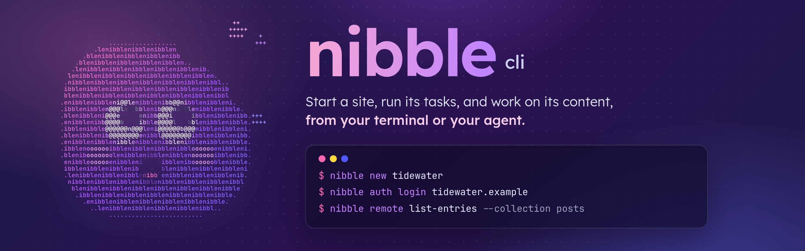

<p align="center"></p>

# nibble

The command-line tool for [Nibble](https://nibble.ink). It starts a site, runs a site's tasks, and works on the
content of any Nibble site you sign in to, as you and never as more than you.

## Install

For macOS and Linux, on Intel or ARM:

```sh
curl -LsSf https://github.com/mah3uz/nibble-cli/releases/latest/download/nibble-cli-installer.sh | sh
```

For Windows, in PowerShell:

```powershell
irm https://github.com/mah3uz/nibble-cli/releases/latest/download/nibble-cli-installer.ps1 | iex
```

Either puts `nibble` in `~/.local/bin`. Each release also has a `sha256.sum` for checking a download by hand. From a
clone, `just install` builds it and does the same, and tells you if `~/.local/bin` isn't on your `PATH` yet.

## Start a site

```sh
nibble new my-site            # checks this computer, fetches the latest release, verifies it, and installs
```

## Run a site's tasks

Inside a site's folder, any word that isn't one of the tool's own runs a task: `nibble check` is
`bin/rails nibble:check`, `nibble schema show collections/posts` is `bin/rails nibble:schema:show collections/posts`.

## Work on a site's content

```sh
nibble auth login example.com          # opens the site in your browser to sign in and choose what the CLI may do
nibble remote                          # what this connection can do on the site
nibble remote list-entries --collection posts
nibble remote update-entry --id 12 --lock-version 3 --data '{"title":"Better title"}' --dry-run
```

Every operation comes from the site itself, so `nibble remote` always matches the site you're signed in to.
Changes to entries are drafts until someone who may publish does. Add `--dry-run` to see a change without saving it.
What this connection can't do is listed after the rest, with the access it needs.

- **Upload a file:** `nibble remote upload-asset --file photo.jpg --folder Blog --alt "A cat"` sends the file from your
  computer (streamed, under its own name unless you add `--filename`) and makes the asset from it.
- **Changes that need approval:** some changes wait for the person you act for. The command prints their link and waits
  while they approve it in the Control Plane, then prints the result as usual. Ctrl-C stops waiting and leaves the
  request open (`nibble remote get-approval --approval <id>` checks on it later); `--no-wait` prints the link and
  returns at once. With `--json` or a pipe it never waits and answers with the `approval_required` error and its link.
  A request left waiting exits with status 2, apart from a failure's 1, so a script can tell the two apart.

- **More than one site or account:** `nibble auth list`, `nibble auth switch example.com:you@example.com`, or
  `--site` on any command.
- **A folder that always means one site:** put `site = "example.com"` in `.nibble.toml` and run `nibble auth allow`
  there once. A `.nibble.toml` you haven't allowed is refused, so a cloned repository can't point your commands at a
  site you didn't choose.
- **Scripts and CI:** create a token under *Connected apps* in the site's Control Plane, then set `NIBBLE_SITE` and
  `NIBBLE_TOKEN`.
- **A server without a browser:** `nibble auth login example.com --device`, if the site allows signing in with a code.

Sign-ins are kept in this system's keychain. Where there is none, `--insecure-storage` keeps them in a file only you
can read, and `nibble doctor` says so.

## AI apps

```sh
cd my-project
nibble connect example.com      # signs in if needed, then adds the MCP server and the site's guide to every app found
nibble connect --client codex   # only these apps (claude-code, codex, cursor; claude and chatgpt print where to paste the address)
nibble disconnect example.com   # removes them again; it doesn't sign you out, `nibble auth logout` does
```

A site's tools and guide load only where you work on that site, so `connect` installs into the current project and
never user-wide: Claude Code gets `claude mcp add --scope project` and `./.claude/skills`, Codex
`./.codex/config.toml` (it reads that once you trust the project) and `./.codex/skills`, and Cursor
`./.cursor/mcp.json`. A folder that is another Nibble site's project is refused, so one site's tools never land in
another's; run it from the site's own folder or a folder that isn't a Nibble site.

`connect` never asks questions and can be run again: the server entry is replaced and the skill refreshed. It looks
for Claude Code, Codex and Cursor, and prints the MCP address when it finds none. `disconnect` removes only that
site's entries and skill folders from the current project, and from the user-wide places older versions of nibble
wrote to, and leaves everything else alone.

For finer control, `nibble mcp install --client claude-code` and `nibble skill install --client claude` do each part
alone (also into the current project), and `nibble skill sync` refreshes the project's installed skills.

After `nibble auth login`, nibble offers to run the same on a terminal, and prints `nibble connect <site>` when it
can't ask. `nibble doctor` shows when the sign-in ends if it goes unused.

The site must have Agent access turned on by an administrator.

## Shell completion

Add the line for your shell, then open a new terminal:

| Shell | Where | Line |
|---|---|---|
| bash | `~/.bashrc` | `eval "$(nibble completion bash)"` |
| zsh | `~/.zshrc`, after `compinit` | `eval "$(nibble completion zsh)"` |
| fish | run once | `nibble completion fish > ~/.config/fish/completions/nibble.fish` |
| PowerShell | `$PROFILE` | `nibble completion powershell \| Out-String \| Invoke-Expression` |

Tab then completes, with a description beside each choice where the shell shows one:

- **Commands and their options**, and only the options not given yet.
- **Inside a site, its tasks**: `nibble sch` → `schema`, `nibble schema ` → `show`, `snapshot`, `types`.
- **Your sites and accounts** for `--site`, `auth switch` and `auth logout`; your sites for `auth login`; the apps for
  `--client`.
- **What this connection can do on the site**: `nibble remote ` offers its operations, marking those that change
  content; after one, its arguments; after an argument, its values: the collections, taxonomies, global sets and menus
  you may use, the blueprints of the collection already given, the site's locales, and statuses and actions. `--data`
  offers `-` for standard input or `@` and a file.

Pressing Tab never contacts the site, reads the keychain, or runs anything in the folder you're in. It reads what
`nibble remote` last learned from the site and saved beside your settings; signing in saves the first. After changing
a site's schema, `nibble remote describe-site` brings completion up to date; otherwise it catches up within the hour.
A site's tasks are learned when `nibble new` makes it, and otherwise the first time you run one, or `nibble doctor`,
there.


On a terminal, lists print as tables and records as aligned fields, with colour for headings, operations and anything
that changes content. `NO_COLOR=1` turns colour off, and it is never sent to a pipe or a file. Otherwise, or with
`--json`, every command prints `{"ok": true, "data": …, "site": …}` or `{"ok": false, "error": {"code", "message",
"hint"}}`. `--pick entries.0.title` prints just that value, for a script to capture.

## Developing

The CLI is built with Rust and [just](https://github.com/casey/just):

```sh
just test                  # formatting, clippy, unit tests, then the contract test against ../ (or: just test <path>)
just build                 # an optimised build at target/release/nibble
just install               # build it and put it in ~/.local/bin
```

The contract test starts a Nibble checkout on a test database, gives the CLI a token, and works on content through
the management API, so the CLI and Nibble can't drift apart unnoticed. Keep this repository in a Nibble checkout's
`cli/` folder: `just test` finds Nibble at `..`, and Nibble's own release script runs `script/ci` from there before it
tags a release.

`nibble remote` reads each site's operations at run time, so a new operation needs no new CLI. What the CLI relies on
is the management API's contract number, `Nibble::MANAGEMENT_API_VERSION`; `API_VERSION` in `src/api.rs` must match
it, and every answer is checked against it.

## Releasing

```sh
just release 0.2.0
```

It refuses a malformed or backwards version, a tag that exists, a dirty tree, a branch other than `main`, and an
empty `Unreleased` section in `CHANGELOG.md`. Then it sets the version in `Cargo.toml`, dates the changelog section,
runs `script/ci`, and only then commits and tags. If the checks fail, nothing is committed or tagged.

It then offers to push. The pushed tag starts [dist](https://github.com/axodotdev/cargo-dist)'s workflow in
`.github/workflows/release.yml`, which builds these and publishes them with the installers and checksums as a GitHub
release, its notes taken from the changelog:

| Target | Built on |
|---|---|
| `x86_64-unknown-linux-musl` | `ubuntu-22.04` |
| `aarch64-unknown-linux-musl` | `ubuntu-24.04-arm` |
| `aarch64-apple-darwin` | `macos-14` |
| `x86_64-apple-darwin` | `macos-15-intel` |
| `x86_64-pc-windows-msvc` | `windows-2022` |

Linux builds are static, so one runs on any distribution. macOS builds aren't signed; installed with `curl`, macOS
doesn't quarantine them, so they run without a warning. The settings are in
`dist-workspace.toml`; after changing them, run `dist generate` to rewrite the workflow, and `dist plan` to see what a
release would build.
